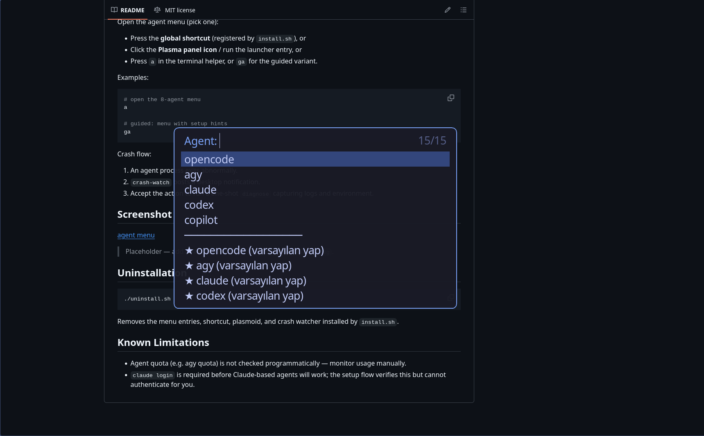

# cachyAgent

Agentic layer for KDE / CachyOS: a fast launcher menu, guided setup flow, crash detection with one-shot diagnosis, local usage tracking with a Plasma widget, and a global shortcut.

## Features

- **8-agent menu** — pick from 8 configured agents in a `fuzzel` picker (search, arrow keys, Enter to launch).
- **Two-part catalog** — global agent definitions plus per-project overrides, merged at menu build time.
- **Guided setup flow** — interactive first-run installer that checks dependencies and writes config.
- **Crash notification + diagnose** — a `crash-watch` helper detects abnormal agent exits, sends a desktop notification, and offers a one-shot `diagnose` run.
- **Usage tracking + plasmoid** — lightweight local collectors log agent runs; a Plasma 6 plasmoid shows recent usage at a glance.
- **Global shortcut** — one keybinding opens the agent menu from anywhere in Plasma.

## Requirements

- CachyOS / Arch Linux
- KDE Plasma 6
- `fuzzel`
- `alacritty`
- `fish`
- `mise`

## Installation

```bash
./install.sh
```

The installer checks the requirements above, installs the menu scripts, registers the global shortcut, installs the plasmoid, and enables the crash watcher.

## Usage

Open the agent menu (pick one):

- Press the **global shortcut** (registered by `install.sh`), or
- Click the **Plasma panel icon** / run the launcher entry, or
- Press `a` in the terminal helper, or `ga` for the guided variant.

Examples:

```bash
# open the 8-agent menu
a

# guided: menu with setup hints
ga
```

Crash flow:

1. An agent process exits abnormally.
2. `crash-watch` posts a desktop notification.
3. Accept the action to run a one-shot `diagnose` capturing logs and environment.

## Screenshot



> Placeholder — add a real screenshot at `docs/screenshot-menu.png`.

## Uninstallation

```bash
./uninstall.sh
```

Removes the menu entries, shortcut, plasmoid, and crash watcher installed by `install.sh`.

## Known Limitations

- Agent quota (e.g. agy quota) is not checked programmatically — monitor usage manually.
- `claude login` is required before Claude-based agents will work; the setup flow verifies this but cannot authenticate for you.
